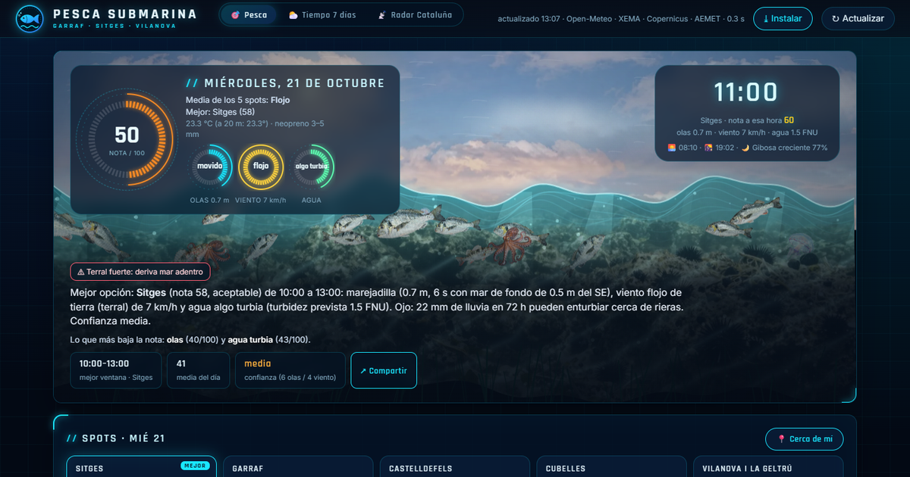
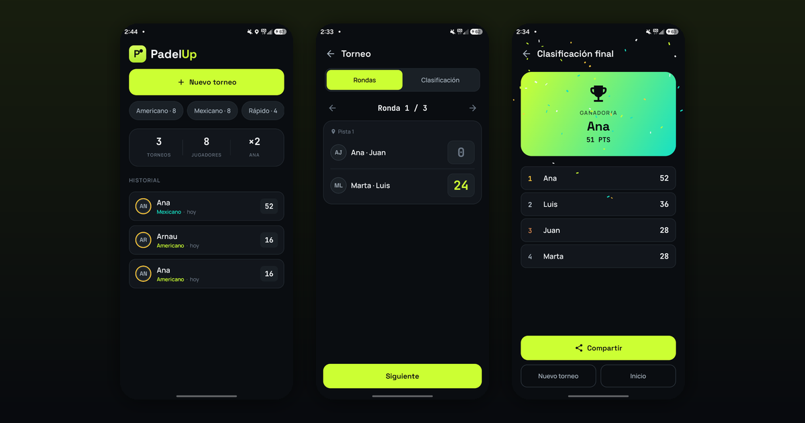
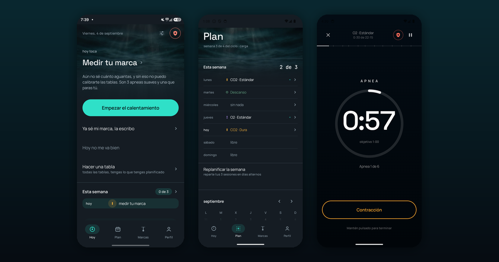
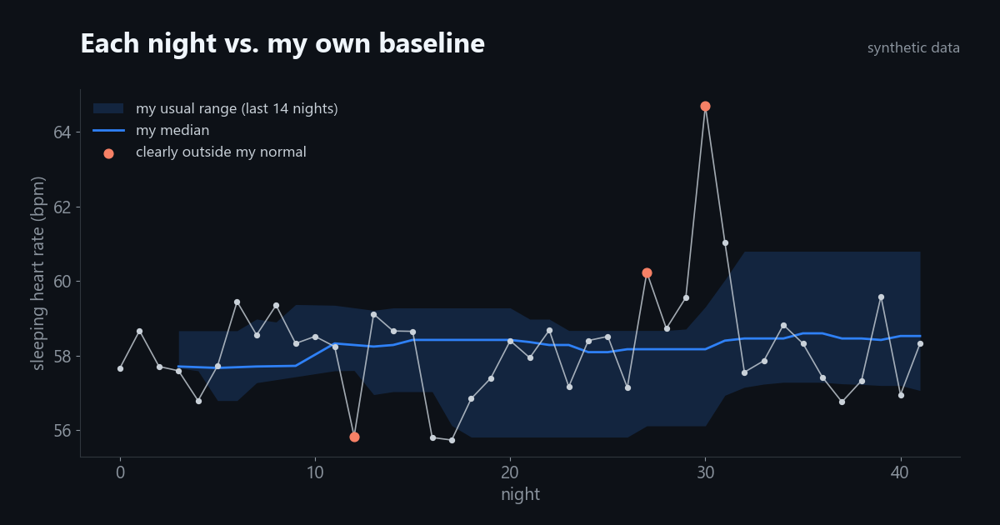

### Hi, I'm Arnau 👋

I'm in my last year of Computer Engineering at UPF (Barcelona) and I work as a software engineering intern at **Accenture Song**, on generative AI assistants and agents. In the evenings I do technical support at **Framer**.

Most of what I know I learned by building things I actually needed: an app that tells me whether it's worth going spearfishing tomorrow, another one to run padel tournaments, a freediving trainer, and a health diary that knows what "normal" looks like for me. For my thesis I'm taking a wireless alarm apart, from its debug port to its radio.

## Things I've built

<table>
<tr>
<td width="50%" valign="top">
 
<b><a href="https://github.com/Arnau000z/pesca-garraf">Pesca Garraf</a></b> 
Scores every hour and every spot on the Garraf coast for spearfishing, ten days ahead, from more than 15 public weather and ocean sources. Sea map, radar and 3D species sheets included. 
JavaScript · PWA · MapLibre · three.js · Python
</td>
<td width="50%" valign="top">
 
<b><a href="https://github.com/Arnau000z/padelup">PadelUp</a></b> 
Runs a social padel tournament from your phone: fair Americano pairings, Mexicano rounds built from the live ranking, scores, standings and a podium at the end. Works offline. 
Kotlin · Jetpack Compose
</td>
</tr>
<tr>
<td width="50%" valign="top">
 
<b><a href="https://github.com/Arnau000z/abisal">Abisal</a></b> 
Freediving training for Android. It builds CO₂ and O₂ tables from your personal best, runs the session hands-free with voice cues and keeps a logbook, with safety limits you can't skip. 
Kotlin · Jetpack Compose · Coroutines
</td>
<td width="50%" valign="top">
 
<b><a href="https://github.com/Arnau000z/salud">Salud</a></b> 
A daily health diary that compares each night with my own last two weeks instead of population averages. Ring, phone, weather and meals end up in one record. 
Python · SQLite · PWA
</td>
</tr>
</table>

**Also on here**

- [iot-alarm-security-thesis](https://github.com/Arnau000z/iot-alarm-security-thesis): my thesis. Debug access, custom firmware and radio analysis on a commercial wireless alarm.
- [clarit-market](https://github.com/Arnau000z/clarit-market): type a stock ticker and get a fundamental and technical report in Spanish, written by an LLM from live market data.
- [apuestas-bot](https://github.com/Arnau000z/apuestas-bot): looks for value bets in LaLiga and the Champions League with a Poisson / Dixon-Coles model.
- [upf-bot](https://github.com/Arnau000z/upf-bot): ask your UPF timetable in plain Spanish on Telegram.
- [subasta-bot](https://github.com/Arnau000z/subasta-bot) and [sp500-timer](https://github.com/Arnau000z/sp500-timer): a BOE auction watcher and a "is the S&P 500 cheap today?" dashboard.

**Not public, but happy to show them in a call**

- *Barcelona: Far from home*, for the Mobile Data Challenge 2026 (Cátedra Telefónica UPF-UPC, team of 5): does mobile-network data anticipate housing pressure, neighbourhood by neighbourhood?
- A SaaS for dental professionals where I run the technical side (Next.js, PostgreSQL, payments, two-factor auth).
- A real-estate auction analytics platform built on open public data (Python, FastAPI, maps).
- A browser game portal for my friends: 17 real-time multiplayer games with server-side simulation (Node.js, WebSockets).
- A commit-reveal auction protocol with smart contracts, built at a [hackathon](https://github.com/MarcLopezCampillejo/oscarshackathon) in March 2026.

## What I use most

Plus LLM APIs and agents, pandas, Ghidra and Wireshark.

## About me

BSc in Computer Engineering at Universitat Pompeu Fabra (2022–2027, taught in English), with an Erasmus year at Babeș-Bolyai University in Cluj-Napoca (2025–2026). I speak Catalan, Spanish and English, and I'm slowly learning Japanese. I'm most interested in applied AI, data science, automation and cybersecurity.

[LinkedIn](https://www.linkedin.com/in/arnau000z)
